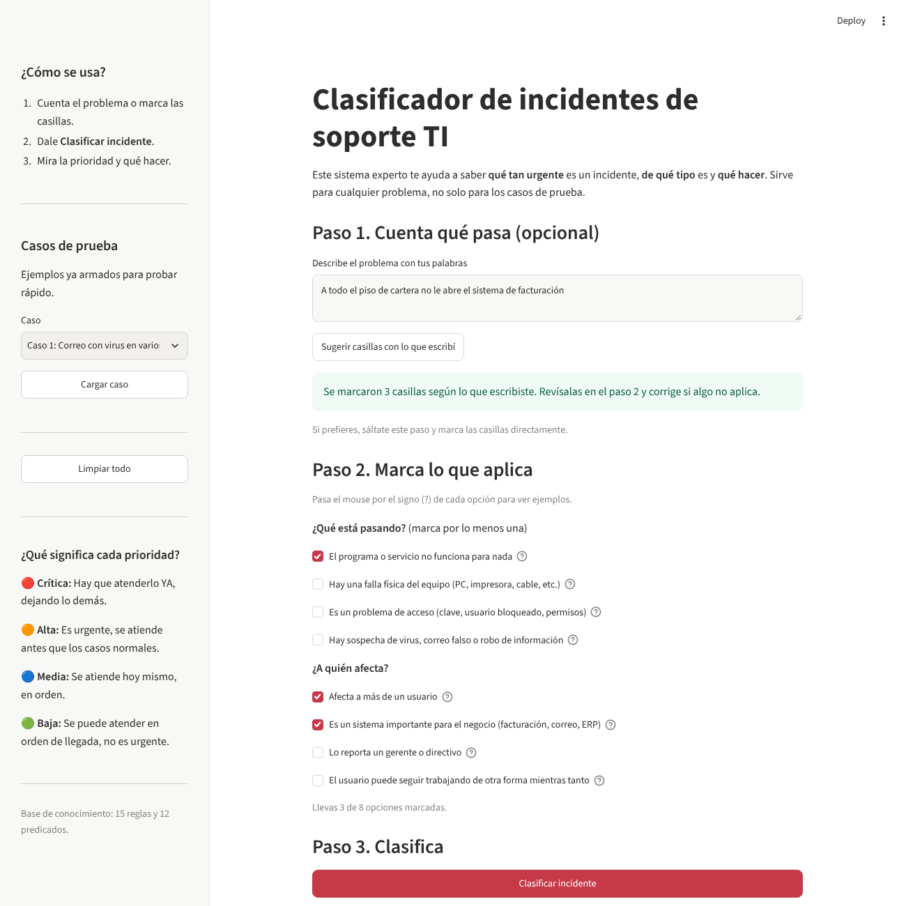
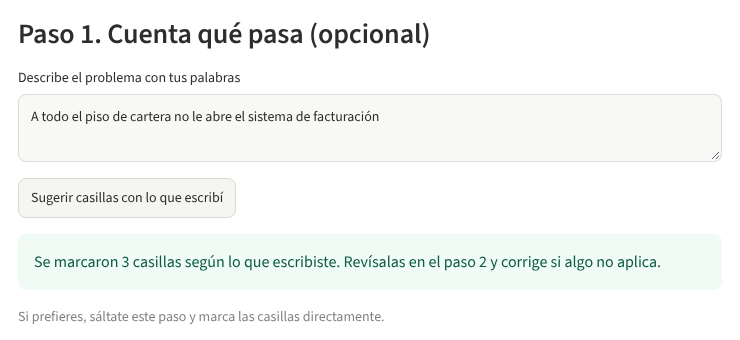
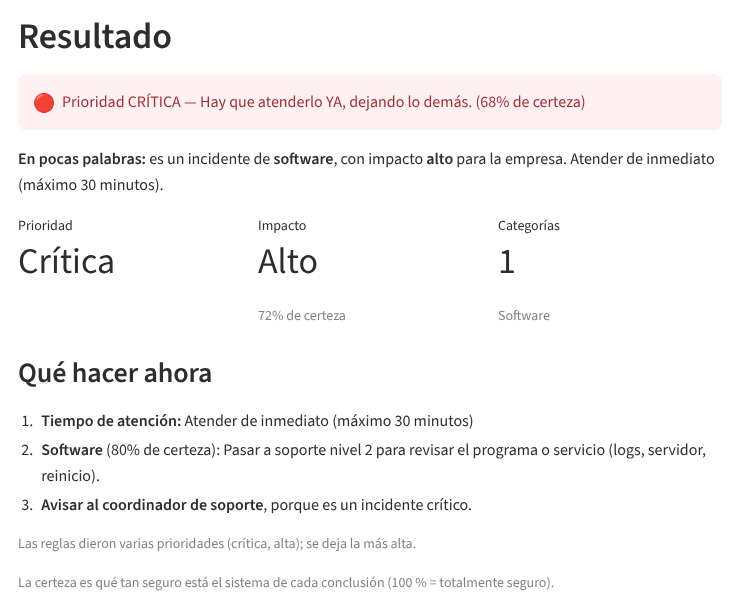
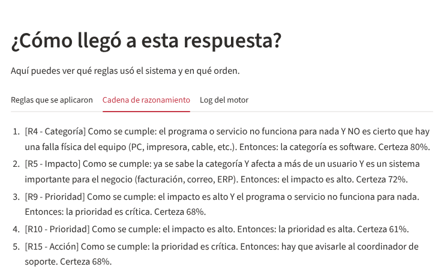
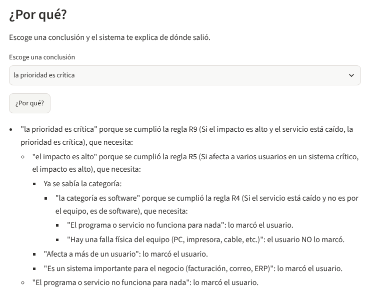
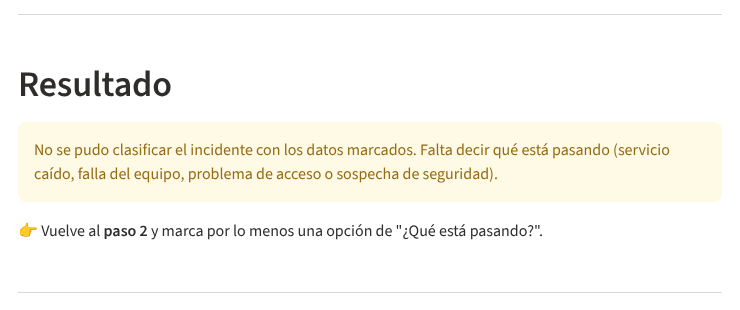
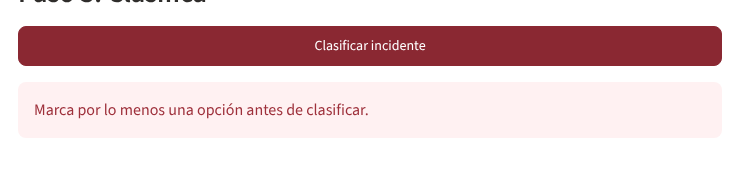

# Sistema experto para clasificar incidentes de soporte TI

Proyecto final de **Inteligencia Artificial II**, Fundación Universitaria Los Libertadores.

Integrantes:
- Edison Daniel Suárez
- Brayan Darío Madera

## App en línea

La aplicación está publicada en Streamlit Community Cloud y se puede usar sin instalar nada:

**https://suarez-madera-sbc.streamlit.app/**

(Si lleva varios días sin usarse puede salir un botón para "despertarla"; se le da clic y en unos segundos carga.)

## De qué se trata

Es un sistema experto (sistema basado en conocimiento) con una página web hecha en Streamlit. Sirve para clasificar los incidentes que llegan a una mesa de ayuda de TI.

La persona de soporte marca lo que está pasando con el incidente (si el servicio está caído, si es una falla del equipo, si afecta a varios usuarios, etc.) y el sistema le dice:

- **Qué tipo de incidente es:** seguridad, hardware, acceso o software.
- **Qué tanto afecta:** impacto alto, medio o bajo.
- **Con qué prioridad se debe atender:** crítica, alta, media o baja, con el tiempo de atención.
- **Qué hacer** y si hay que avisarle al coordinador.

También explica cómo llegó a esa respuesta: qué reglas usó, en qué orden, y un botón "¿Por qué?" para ver la cadena completa.

La base de conocimiento tiene **12 predicados** y **15 reglas**. El motor usa **encadenamiento hacia adelante**.

## Estructura del proyecto

```
suarez-madera-sbc/
├── README.md
├── requirements.txt
├── src/
│   ├── base_conocimiento.py   # predicados, reglas, recomendaciones y ayudas de la página
│   ├── motor_inferencia.py    # encadenamiento hacia adelante y explicaciones
│   ├── casos_prueba.py        # casos precargados (para la demo y las pruebas)
│   └── app.py                 # página web en Streamlit
├── docs/
│   ├── documentacion_tecnica.pdf   (y .docx editable)
│   ├── manual_usuario.pdf          (y .docx editable)
│   └── img/                   # capturas de la app que salen en este README
└── tests/
    ├── casos_prueba.md        # tabla con los casos de prueba
    └── probar_casos.py        # script que corre todos los casos
```

No hay carpetas `templates/` ni `static/` porque esas solo se usan con Flask. Con Streamlit no hacen falta.

## Instalación

Se necesita **Python 3.8 o superior**.

1. Descargar el proyecto:
   ```
   git clone https://github.com/Danielsuarez1-ops/suarez-madera-sbc.git
   cd suarez-madera-sbc
   ```
2. (Opcional) Crear un entorno virtual:
   ```
   python -m venv venv
   venv\Scripts\activate        # en Windows
   source venv/bin/activate     # en Mac/Linux
   ```
3. Instalar las dependencias:
   ```
   pip install -r requirements.txt
   ```

## Cómo ejecutarlo

Desde la carpeta principal del proyecto:

```
streamlit run src/app.py
```

Se abre solo en el navegador en `http://localhost:8501`. Si no se abre, copiar esa dirección en el navegador.

Para correr los casos de prueba sin abrir la página:

```
python tests/probar_casos.py
```

Debe salir `10 de 10 casos salieron bien`.

## Cómo se usa (rápido)

La página está organizada en 3 pasos:

1. **Paso 1 (opcional):** escribir el problema con sus propias palabras y darle **Sugerir casillas con lo que escribí**. El sistema marca las casillas que parecen aplicar.
2. **Paso 2:** revisar y marcar las casillas de lo que está pasando y a quién afecta. Cada opción tiene un signo **(?)** con ejemplos. También se puede cargar un caso de prueba desde la barra de la izquierda.
3. **Paso 3:** darle **Clasificar incidente**.

Después sale el resultado (prioridad, impacto, categoría y qué hacer) y la explicación con las reglas usadas y el botón **¿Por qué?**. Con **Clasificar otro incidente** o **Limpiar todo** se empieza de nuevo.

El manual completo está en `docs/manual_usuario.pdf`.

## ¿Sirve solo para los 10 casos de prueba?

No. Los 10 casos son solo ejemplos para probar rápido. El sistema clasifica **cualquier incidente**, porque lo que usa son las 8 casillas, y cualquier problema se puede describir con ellas.

El cuadro de texto del paso 1 ayuda a marcar las casillas: busca palabras como "virus", "clave", "impresora", "no abre", "todos" o "gerente" y marca la casilla que corresponde. Pero **no clasifica por sí solo**: la clasificación la siguen haciendo las 15 reglas con las casillas marcadas. Por eso siempre hay que revisar las casillas antes de darle clasificar.

## Ejemplo de uso (con capturas reales)

Para el ejemplo usamos un problema que **no está** en los casos de prueba: *"A todo el piso de cartera no le abre el sistema de facturación"*.

**1. Pantalla principal.** A la izquierda está la ayuda de cómo se usa, los casos de prueba y qué significa cada prioridad. En el centro están los 3 pasos.



**2. Se escribe el problema y se le da "Sugerir casillas".** El sistema reconoce "no le abre", "todo el piso" y "facturación", y marca 3 casillas: el servicio no funciona, afecta a más de un usuario y es un sistema importante. Siempre avisa que hay que revisarlas.



**3. Se le da "Clasificar incidente".** Sale la prioridad **crítica** en rojo, con lo que significa ("hay que atenderlo YA"), un resumen en una frase y la lista de qué hacer: atender en máximo 30 minutos, pasar a soporte nivel 2 y avisar al coordinador.



**4. Se revisa cómo llegó a la respuesta.** En pestañas están las reglas que se aplicaron, la cadena de razonamiento (en la imagen) y el log del motor.



**5. Se le pregunta "¿Por qué?".** Se escoge una conclusión y el sistema explica de dónde salió, yendo hacia atrás hasta lo que marcó el usuario.



**¿Y si faltan datos?** Si solo se marca, por ejemplo, que afecta a varios usuarios y que es un gerente, pero no se dice qué está pasando, el sistema avisa que no puede clasificarlo y dice qué falta (Caso 6):



Y si se le da clasificar sin marcar nada, no deja seguir:



## Mejoras a la interfaz

Después de la primera versión le hicimos cambios a la página para que fuera más fácil de entender, sin quitarle nada de lo que ya tenía:

- La página quedó en **3 pasos numerados**, para que se sepa qué hacer primero.
- El cuadro de descripción ahora sirve: con **Sugerir casillas** marca las opciones según lo que se escribió.
- Cada casilla tiene un signo **(?)** con ejemplos de cuándo marcarla.
- En la barra izquierda hay una ayuda de **cómo se usa** y qué significa **cada prioridad**.
- El resultado dice la prioridad **en palabras** ("hay que atenderlo YA") y trae un resumen en una frase.
- "Qué hacer ahora" quedó como una **lista numerada**.
- La explicación quedó organizada en **pestañas** (reglas, cadena de razonamiento y log), para que no se vea todo amontonado.
- Se agregó el botón **Clasificar otro incidente** al final del resultado.

## Dificultades que tuvimos

No fue todo a la primera. Estas fueron las cosas que más nos hicieron pensar:

1. **Los resultados se borraban al darle "¿Por qué?".** Streamlit vuelve a correr todo el archivo cada vez que uno da un clic, y se perdía lo que ya se había calculado. Lo arreglamos guardando el resultado en `st.session_state`.

2. **Los textos de las casillas se cortaban.** Al principio estaban en dos columnas y las frases largas quedaban con "...". Las pasamos a una sola columna y ya se leen completas.

3. **Publicarla en Streamlit Cloud.** Por defecto Streamlit busca un archivo llamado `streamlit_app.py` en la carpeta principal, y el nuestro es `src/app.py`, así que hubo que cambiar esa ruta al configurar la app. También tocó darle permiso a Streamlit para leer el repositorio de GitHub.

