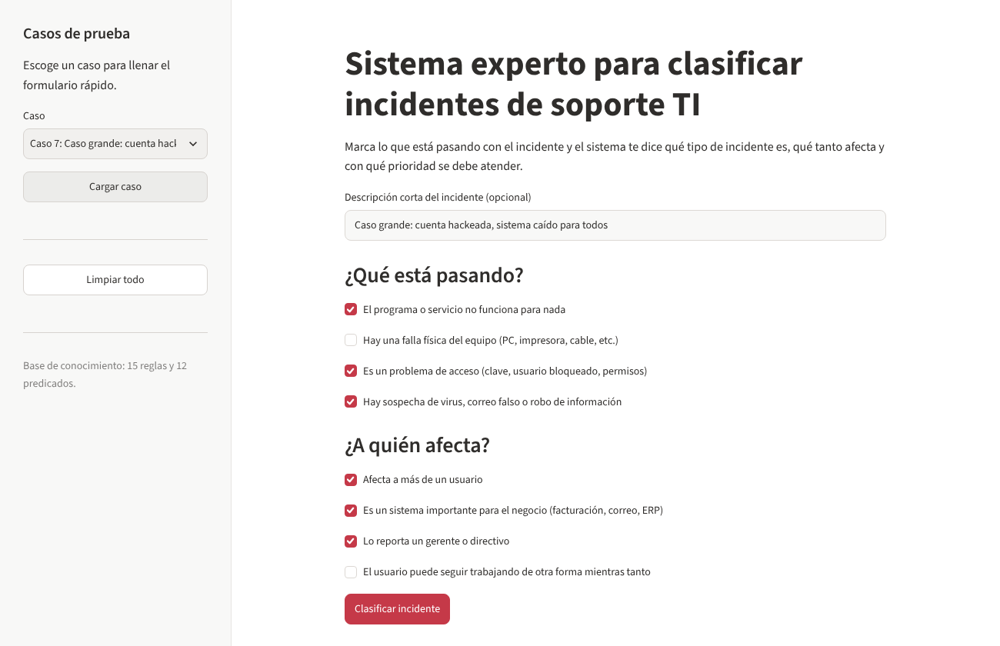
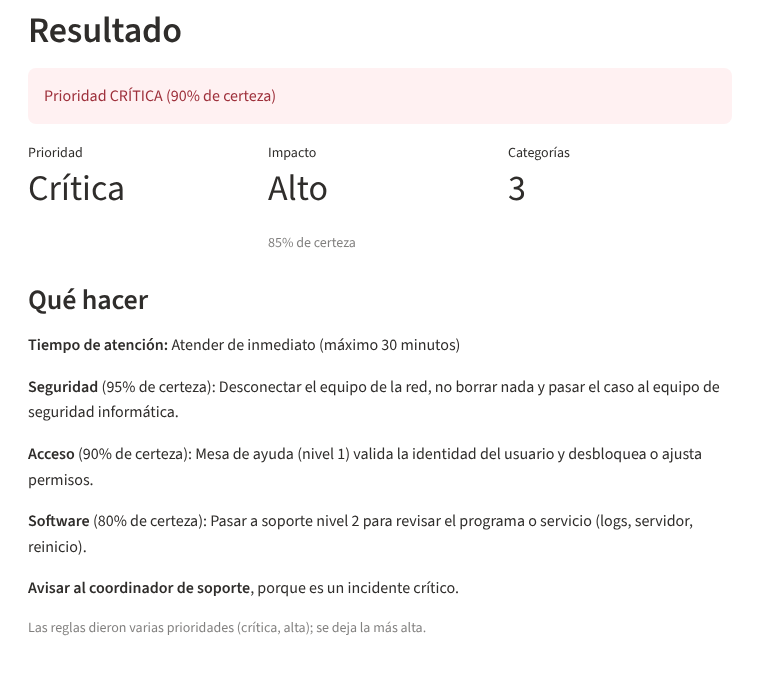
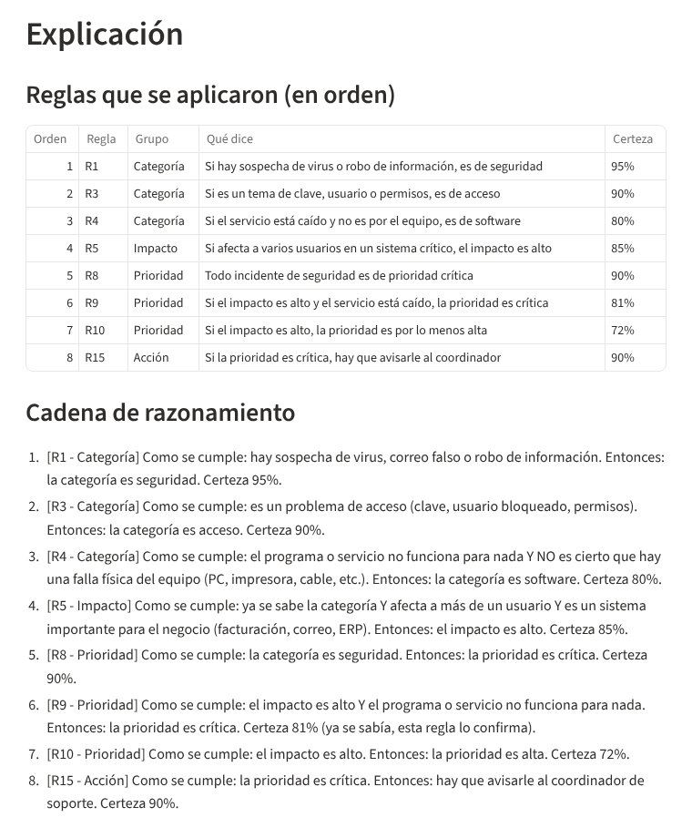
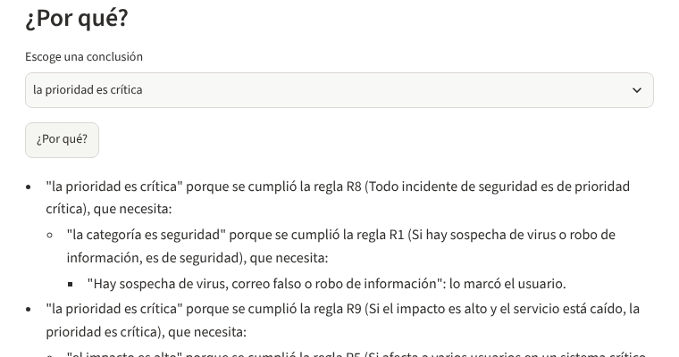
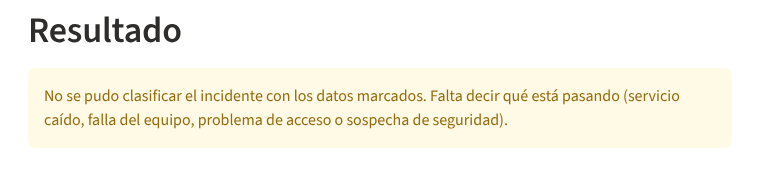
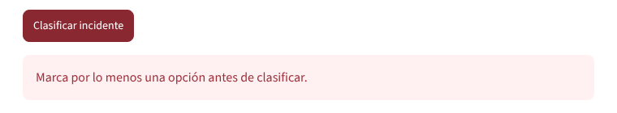

# Sistema experto para clasificar incidentes de soporte TI

Proyecto final de **Inteligencia Artificial II**, Fundación Universitaria Los Libertadores.

Integrantes:
- Edison Daniel Suárez
- Brayan Darío Madera

## App en línea

La aplicación está publicada en Streamlit Community Cloud y se puede usar sin instalar nada:

**https://suarez-madera-sbc.streamlit.app/**

(Si lleva varios días sin usarse puede salir un botón para "despertarla"; se le da clic y en unos segundos carga.)

## De qué se trata

Es un sistema experto (sistema basado en conocimiento) con una página web hecha en Streamlit. Sirve para clasificar los incidentes que llegan a una mesa de ayuda de TI.

La persona de soporte marca lo que está pasando con el incidente (si el servicio está caído, si es una falla del equipo, si afecta a varios usuarios, etc.) y el sistema le dice:

- **Qué tipo de incidente es:** seguridad, hardware, acceso o software.
- **Qué tanto afecta:** impacto alto, medio o bajo.
- **Con qué prioridad se debe atender:** crítica, alta, media o baja, con el tiempo de atención.
- **Qué hacer** y si hay que avisarle al coordinador.

También explica cómo llegó a esa respuesta: qué reglas usó, en qué orden, y un botón "¿Por qué?" para ver la cadena completa.

La base de conocimiento tiene **12 predicados** y **15 reglas**. El motor usa **encadenamiento hacia adelante**.

## Estructura del proyecto

```
suarez-madera-sbc/
├── README.md
├── requirements.txt
├── src/
│   ├── base_conocimiento.py   # predicados, reglas y tablas de recomendaciones
│   ├── motor_inferencia.py    # encadenamiento hacia adelante y explicaciones
│   ├── casos_prueba.py        # casos precargados (para la demo y las pruebas)
│   └── app.py                 # página web en Streamlit
├── docs/
│   ├── documentacion_tecnica.pdf   (y .docx editable)
│   ├── manual_usuario.pdf          (y .docx editable)
│   └── img/                   # capturas de la app que salen en este README
└── tests/
    ├── casos_prueba.md        # tabla con los casos de prueba
    └── probar_casos.py        # script que corre todos los casos
```

No hay carpetas `templates/` ni `static/` porque esas solo se usan con Flask. Con Streamlit no hacen falta.

## Instalación

Se necesita **Python 3.8 o superior**.

1. Descargar el proyecto:
   ```
   git clone https://github.com/Danielsuarez1-ops/suarez-madera-sbc.git
   cd suarez-madera-sbc
   ```
2. (Opcional) Crear un entorno virtual:
   ```
   python -m venv venv
   venv\Scripts\activate        # en Windows
   source venv/bin/activate     # en Mac/Linux
   ```
3. Instalar las dependencias:
   ```
   pip install -r requirements.txt
   ```

## Cómo ejecutarlo

Desde la carpeta principal del proyecto:

```
streamlit run src/app.py
```

Se abre solo en el navegador en `http://localhost:8501`. Si no se abre, copiar esa dirección en el navegador.

Para correr los casos de prueba sin abrir la página:

```
python tests/probar_casos.py
```

Debe salir `10 de 10 casos salieron bien`.

## Cómo se usa (rápido)

1. Marcar las casillas de lo que está pasando y a quién afecta, o cargar un caso de prueba desde la barra de la izquierda.
2. Darle **Clasificar incidente**.
3. Ver el resultado (prioridad, impacto, categoría y qué hacer).
4. Bajar a **Explicación** para ver las reglas usadas y darle **¿Por qué?** para ver el detalle.
5. **Limpiar todo** para empezar otro incidente.

El manual completo está en `docs/manual_usuario.pdf`.

## Ejemplo de uso (con capturas reales)

Para el ejemplo usamos el **Caso 7**: a un usuario le hackearon la cuenta y, por eso, el sistema de facturación quedó caído para toda el área. Lo reporta un gerente.

**1. Se cargan los datos del incidente.** Desde la barra de la izquierda se escoge el caso y se le da "Cargar caso". Las casillas quedan marcadas solas (también se pueden marcar a mano).



**2. Se le da "Clasificar incidente".** El sistema dice que la prioridad es **crítica** (sale en rojo), que el impacto es **alto** y que el incidente cae en 3 categorías: seguridad, acceso y software. Debajo sale qué hacer con cada una y que hay que avisarle al coordinador.



**3. Se revisa la explicación.** Aparecen las reglas que se usaron, en orden y con su certeza, y la cadena de razonamiento escrita en palabras. En este caso se activaron 8 de las 15 reglas.



**4. Se le pregunta "¿Por qué?".** Se escoge una conclusión y el sistema explica de dónde salió, yendo hacia atrás hasta lo que marcó el usuario.



**¿Y si faltan datos?** Si solo se marca, por ejemplo, que afecta a varios usuarios y que es un gerente, pero no se dice qué está pasando, el sistema avisa que no puede clasificarlo (Caso 6):



Y si se le da clasificar sin marcar nada, no deja seguir:



## Dificultades que tuvimos

No fue todo a la primera. Estas fueron las cosas que más nos hicieron pensar:

1. **Dos reglas daban prioridades distintas.** Con un virus en un solo PC, una regla decía "crítica" (por ser de seguridad) y otra decía "baja" (porque es un solo usuario). Lo resolvimos haciendo que cada regla diga la prioridad *mínima* y que al final quede la más alta. En soporte es mejor pasarse que quedarse corto.

2. **Un PC dañado salía también como problema de software.** Si el computador no prende, obviamente el programa tampoco abre, y el sistema lo marcaba como las dos cosas. Le agregamos a la regla R4 la condición "y NO hay falla del equipo".

3. **Los resultados se borraban al darle "¿Por qué?".** Streamlit vuelve a correr todo el archivo cada vez que uno da un clic, y se perdía lo que ya se había calculado. Lo arreglamos guardando el resultado en `st.session_state`.

4. **Los textos de las casillas se cortaban.** Al principio estaban en dos columnas y las frases largas quedaban con "...". Las pasamos a una sola columna y ya se leen completas.

5. **Publicarla en Streamlit Cloud.** Por defecto Streamlit busca un archivo llamado `streamlit_app.py` en la carpeta principal, y el nuestro es `src/app.py`, así que hubo que cambiar esa ruta al configurar la app. También tocó darle permiso a Streamlit para leer el repositorio de GitHub.

## Video de demo

Link: _(pendiente)_
